# Codebase Context & Architectural Relationship Graph

This document serves as the single source of truth for AI agents and developers to understand the architecture, data flow, component dependencies, and file relationships of the **Stock Market AI Trend Prediction & Risk Analysis Platform**.

---

## 1. System Overview Architecture

The application is organized into three decoupled layers:
1. **Frontend**: Vite + React 18 single-page application with canvas charting, glassmorphism UI, and resilient mock fallbacks.
2. **Backend**: FastAPI REST API providing authentication, data ingestion, quantitative risk calculations, and portfolio management.
3. **AI Engine**: PyTorch deep learning pipeline (LSTM, GRU, TimeSeriesTransformer, Stacking Ensemble) with walk-forward validation and conformal confidence interval calibration.

```mermaid
graph TD
    subgraph Frontend ["Frontend (Vite + React 18)"]
        UI_App["App.jsx (State Coordinator)"]
        UI_API["services/api.js (API Client & Mock Fallbacks)"]
        UI_Charts["CandlestickChart.jsx (Canvas Chart)"]
        UI_Pred["PredictionPanel.jsx"]
        UI_Risk["RiskDashboard.jsx"]
        UI_Port["PortfolioManager.jsx"]
        UI_Sent["SentimentViewer.jsx"]
        UI_Auth["AuthModal.jsx"]
        UI_Watch["WatchlistModal.jsx"]
    end

    subgraph Backend ["Backend (FastAPI)"]
        Main["main.py (App Entry, Middleware, Lifespan)"]
        Config["core/config.py (Settings & CORS)"]
        DB["core/database.py (Motor MongoDB Client)"]
        Sec["core/security.py (JWT & Passlib Bcrypt)"]
        Deps["api/deps.py (Singletons & Auth Injector)"]
        Router["api/v1/router.py (Router Aggregator)"]

        subgraph Endpoints ["API Routers (api/v1/)"]
            R_Auth["auth.py (/auth)"]
            R_Stocks["stocks.py (/stocks)"]
            R_Market["market.py (/market)"]
            R_Pred["predictions.py (/predictions)"]
            R_Risk["risk.py (/risk)"]
            R_Port["portfolio.py (/portfolio)"]
            R_Watch["watchlist.py (/watchlist)"]
            R_Sent["sentiment.py (/sentiment)"]
        end

        subgraph Schemas ["Pydantic V2 Schemas (schemas/)"]
            S_User["user.py"]
            S_Stock["stock.py"]
            S_Pred["prediction.py"]
            S_Risk["risk.py"]
            S_Port["portfolio.py"]
            S_Sent["sentiment.py"]
        end

        subgraph Services ["Backend Services (services/)"]
            Serv_Market["market_data.py (MarketDataService)"]
            Serv_Risk["risk_service.py (RiskAnalysisService)"]
            Serv_Port["portfolio_service.py (PortfolioService)"]
            Serv_Sent["sentiment_service.py (SentimentAnalysisService)"]
        end
    end

    subgraph AIEngine ["AI Deep Learning Engine (ai_engine/)"]
        Pred_Engine["inference/predictor.py (StockPredictorEngine)"]
        Pipe["preprocessing/pipeline.py (FeatureScaler & Windows)"]
        TI["features/technical_indicators.py (SMA, RSI, MACD, etc.)"]
        Ensemble["models/ensemble.py (Stacking Ensemble)"]
        M_LSTM["models/lstm_model.py (LSTMForecaster)"]
        M_GRU["models/gru_model.py (GRUForecaster)"]
        M_Trans["models/transformer_model.py (TimeSeriesTransformer)"]
        Trainer["training/trainer.py (ModelTrainer)"]
        Saved["saved_models/ (*.pt PyTorch Weights)"]
    end

    %% External Data & Stores
    YF[("Yahoo Finance API (yfinance)")]
    Mongo[("MongoDB Database")]

    %% Frontend to Backend
    UI_App --> UI_API
    UI_App --> UI_Charts & UI_Pred & UI_Risk & UI_Port & UI_Sent & UI_Auth & UI_Watch
    UI_API -->|HTTP REST + Bearer JWT| Main

    %% Backend Routing
    Main --> Router
    Router --> R_Auth & R_Stocks & R_Market & R_Pred & R_Risk & R_Port & R_Watch & R_Sent

    %% Endpoint to Schemas
    R_Auth --> S_User
    R_Stocks --> S_Stock
    R_Market --> S_Stock
    R_Pred --> S_Pred
    R_Risk --> S_Risk
    R_Port --> S_Port
    R_Watch --> S_Stock & S_Port
    R_Sent --> S_Sent
    S_Port -.-> S_Risk

    %% Endpoint to Dependencies & Services
    R_Auth --> Sec & DB
    R_Stocks --> Deps
    R_Market --> Deps
    R_Pred --> Deps
    R_Risk --> Deps
    R_Port --> Deps
    R_Watch --> Deps
    R_Sent --> Deps

    Deps --> Serv_Market & Serv_Risk & Serv_Sent & Serv_Port & Pred_Engine
    Serv_Port --> Serv_Market & Serv_Risk

    %% Services to External / AI Engine
    Serv_Market --> YF
    Serv_Market --> TI
    Serv_Sent --> YF
    DB --> Mongo

    %% Inference Engine Relationships
    Pred_Engine --> Pipe & TI & Ensemble & Trainer
    Pred_Engine --> M_LSTM & M_GRU & M_Trans
    Trainer --> Saved
```



---

## 2. Directory Structure & Key Responsibilities

```text
Capstone-II/
├── ai_engine/                   # PyTorch AI Prediction & Feature Engineering
│   ├── features/
│   │   └── technical_indicators.py  # SMA, EMA, MACD, RSI, Bollinger Bands, ATR
│   ├── inference/
│   │   └── predictor.py             # StockPredictorEngine: coordinates forecasting & backtesting
│   ├── models/
│   │   ├── ensemble.py              # StackingEnsemble with confidence intervals
│   │   ├── gru_model.py             # 2-layer GRU architecture
│   │   ├── lstm_model.py            # 2-layer LSTM architecture
│   │   └── transformer_model.py     # TimeSeriesTransformer with multi-head attention
│   ├── preprocessing/
│   │   └── pipeline.py              # MinMaxScaler normalization & sliding window generation
│   ├── saved_models/                # Pre-trained PyTorch weight checkpoints (*.pt)
│   └── training/
│       └── trainer.py               # Early stopping, MSE training loop, checkpointing
│
├── backend/                     # FastAPI Backend Application
│   ├── app/
│   │   ├── api/
│   │   │   ├── deps.py              # Dependency injector (Service singletons, get_current_user)
│   │   │   └── v1/
│   │   │       ├── auth.py          # /auth: register, login (form/json), /me
│   │   │       ├── market.py        # /market: historical OHLCV & technical indicators
│   │   │       ├── portfolio.py     # /portfolio: CRUD positions, valuation, asset allocation
│   │   │       ├── predictions.py   # /predictions: multi-model forecasting endpoint & discovery
│   │   │       ├── risk.py          # /risk: single stock & multi-asset portfolio risk & overview
│   │   │       ├── router.py        # Aggregator combining all sub-routers
│   │   │       ├── sentiment.py     # /sentiment: NLP news scoring & sentiment index
│   │   │       ├── stocks.py        # /stocks: universe listing & ticker metadata
│   │   │       └── watchlist.py     # /watchlist: user watchlist CRUD
│   │   ├── core/
│   │   │   ├── config.py            # Settings, CORS origins parser, JWT & Mongo configs
│   │   │   ├── database.py          # Async Motor MongoDB connection manager & indexer
│   │   │   └── security.py          # Bcrypt hashing & PyJWT encode/decode
│   │   ├── schemas/                 # Pydantic V2 Request/Response validation models
│   │   │   ├── portfolio.py         # PositionEnriched, PortfolioResponse, PortfolioCreate
│   │   │   ├── prediction.py        # ForecastPoint, PredictionResponse, ModelEvaluationMetrics
│   │   │   ├── risk.py              # StockRiskResponse, PortfolioRiskResponse, VaRDetail
│   │   │   ├── sentiment.py         # SentimentResponse, NewsArticle, SentimentBreakdown
│   │   │   ├── stock.py             # StockBase, StockInfo, OHLCVRecord, HistoricalDataResponse
│   │   │   └── user.py              # UserCreate, UserLogin, UserOut, TokenResponse
│   │   ├── services/
│   │   │   ├── market_data.py       # yfinance fetching, TTL cache, synthetic fallback
│   │   │   ├── portfolio_service.py # Portfolio state, position cost basis, P&L
│   │   │   ├── risk_service.py      # Monte Carlo VaR (10k walks), CVaR, Sharpe, MDD
│   │   │   └── sentiment_service.py # NLTK VADER augmented with financial lexicon
│   │   └── main.py                  # FastAPI app factory, GZip, CORS, Process-Time middleware
│   ├── tests/                       # Pytest test suite (17 comprehensive tests)
│   │   ├── conftest.py              # TestClient fixture, test user auth header fixture
│   │   ├── test_auth.py             # User registration, JWT login, profile checks
│   │   ├── test_market_data.py      # Stock listings, metadata, historical OHLCV
│   │   ├── test_portfolio.py        # Portfolio creation, position add/delete, watchlist
│   │   ├── test_predictions.py      # Technical indicator calculation, AI endpoint
│   │   ├── test_risk.py             # Stock risk metrics, multi-asset portfolio covariance
│   │   └── test_sentiment.py        # News sentiment analyzer & endpoint
│   └── requirements.txt             # Backend dependencies
│
└── frontend/                    # Vite + React 18 Frontend Application
    ├── src/
    │   ├── components/
    │   │   ├── AuthModal.jsx        # Login/Register modal dialogue
    │   │   ├── CandlestickChart.jsx # Interactive Canvas OHLCV chart with indicators
    │   │   ├── MarketTickerBar.jsx  # Scrolling top ticker tape
    │   │   ├── Navbar.jsx           # Top navigation, status indicator, active tab switch
    │   │   ├── PortfolioManager.jsx # Portfolio metrics, position table, allocation pie
    │   │   ├── PredictionPanel.jsx  # AI forecast horizon chart, 95% CI cone, model metrics
    │   │   ├── RiskDashboard.jsx    # Risk dial, 4 core ratios, VaR/CVaR tables
    │   │   ├── SentimentViewer.jsx  # Sentiment index gauge, breakdown, news feed
    │   │   └── WatchlistModal.jsx   # Watchlist management modal
    │   ├── services/
    │   │   └── api.js               # Central API client with automatic mock fallbacks
    │   ├── App.jsx                  # Main coordinator managing tabs and active ticker
    │   ├── index.css                # Tailwind CSS 4 directives and glassmorphism styling
    │   └── index.jsx                # React DOM render entry
    ├── package.json
    └── vite.config.js
```

---

## 3. Data Flow & Inter-Component Relationships

### A. Market Data & Candlestick Flow
1. **Frontend**: [`CandlestickChart.jsx`](file:///D:/Project/Capstone-II/frontend/src/components/CandlestickChart.jsx) calls `apiClient.getMarketHistory(symbol, period, interval)`.
2. **Backend**: Dispatches to [`market.py`](file:///D:/Project/Capstone-II/backend/app/api/v1/market.py) `GET /api/v1/market/history/{symbol}`.
3. **Service**: [`MarketDataService.get_historical_records`](file:///D:/Project/Capstone-II/backend/app/services/market_data.py) fetches 1y/2y daily candles via `yfinance` (with in-memory TTL caching and deterministic Geometric Brownian Motion fallback if throttled).
4. **Indicators**: Invokes `compute_technical_indicators(df)` in [`technical_indicators.py`](file:///D:/Project/Capstone-II/ai_engine/features/technical_indicators.py) to calculate SMA-20/50, EMA-12/26, MACD, MACD Signal, RSI-14, and Bollinger Bands.
5. **Database**: Upserts latest 30 candle points into MongoDB collection `historical_prices` (if connected).
6. **Response**: Validated against [`HistoricalDataResponse`](file:///D:/Project/Capstone-II/backend/app/schemas/stock.py) and rendered with HTML5 Canvas.

### B. AI Trend Prediction Flow
1. **Frontend**: [`PredictionPanel.jsx`](file:///D:/Project/Capstone-II/frontend/src/components/PredictionPanel.jsx) calls `apiClient.getPredictions(symbol, horizon, model)`.
2. **Backend**: Handled by [`predictions.py`](file:///D:/Project/Capstone-II/backend/app/api/v1/predictions.py).
3. **Inference**: [`StockPredictorEngine.generate_predictions`](file:///D:/Project/Capstone-II/ai_engine/inference/predictor.py):
   - Computes technical indicators for the entire price series.
   - Splits data into train/val/test windows with 60-day lookback.
   - Loads PyTorch models ([`LSTMForecaster`](file:///D:/Project/Capstone-II/ai_engine/models/lstm_model.py), [`GRUForecaster`](file:///D:/Project/Capstone-II/ai_engine/models/gru_model.py), [`TimeSeriesTransformer`](file:///D:/Project/Capstone-II/ai_engine/models/transformer_model.py)) and checkpoints from `saved_models/`.
   - Executes [`StackingEnsemble`](file:///D:/Project/Capstone-II/ai_engine/models/ensemble.py) to calculate dynamically weighted future price projections and calibrated 95% confidence intervals (`lower_bound` / `upper_bound`).
   - Runs walk-forward backtest evaluation returning MAE, RMSE, MAPE, and Directional Accuracy %.
4. **Classification**: Labels trend as **Bullish** (>1% gain), **Bearish** (<-1% drop), or **Sideways**.
5. **Response**: Validated against [`PredictionResponse`](file:///D:/Project/Capstone-II/backend/app/schemas/prediction.py).

### C. Financial Risk Modeling Flow
1. **Single Stock Risk**:
   - [`RiskDashboard.jsx`](file:///D:/Project/Capstone-II/frontend/src/components/RiskDashboard.jsx) requests [`risk.py`](file:///D:/Project/Capstone-II/backend/app/api/v1/risk.py) `GET /api/v1/risk/{symbol}`.
   - [`RiskAnalysisService`](file:///D:/Project/Capstone-II/backend/app/services/risk_service.py) computes 252-day continuous log return volatility $\sigma$.
   - Executes **10,000-path Monte Carlo Geometric Brownian Motion (GBM)** simulations.
   - Calculates **Parametric, Historical, and Monte Carlo Value at Risk (VaR)** at 95% and 99% confidence levels.
   - Computes **Conditional Value at Risk (CVaR / Expected Shortfall)**.
   - Evaluates peak-to-trough **Maximum Drawdown (MDD)**, **Sharpe Ratio** (4.0% risk-free rate), and **Sortino Ratio** (downside deviation).
   - Classifies asset into *Low Risk*, *Medium Risk*, or *High Risk*.
2. **Multi-Asset Portfolio Risk**:
   - [`portfolio.py`](file:///D:/Project/Capstone-II/backend/app/api/v1/portfolio.py) invokes `calculate_portfolio_risk(holdings_weights, price_matrix)`.
   - Computes the empirical asset covariance matrix $\Sigma$ and asset correlation matrix.
   - Computes total portfolio volatility $\sigma_p = \sqrt{w^T \Sigma w}$ and diversification benefit ratio.

### D. Virtual Portfolio & Watchlist Flow
1. **Creation & Management**: Handled by [`portfolio_service.py`](file:///D:/Project/Capstone-II/backend/app/services/portfolio_service.py).
2. **Position Accounting**:
   - `add_position`: Calculates total cash deduction, updates weighted average purchase price `avg_buy_price = (old_cost + new_cost) / total_qty`.
   - `remove_position`: Decreases position quantity or sells entire lot, credits cash from proceeds at current market price.
   - `get_portfolio_summary`: Enriches all positions with real-time valuation, unrealized P&L $, P&L %, and asset allocation percentage `allocation_pct = (curr_val / total_val) * 100`.
3. **Watchlist**: Users add/remove tickers in [`watchlist.py`](file:///D:/Project/Capstone-II/backend/app/api/v1/watchlist.py); returns enriched [`StockInfo`](file:///D:/Project/Capstone-II/backend/app/schemas/stock.py) records with real-time pricing and changes.

### E. Market Sentiment Analysis Flow
1. **News Acquisition**: [`SentimentAnalysisService`](file:///D:/Project/Capstone-II/backend/app/services/sentiment_service.py) fetches recent news via `yfinance.Ticker.news` with financial template fallbacks.
2. **NLP Scoring**: Uses NLTK's `SentimentIntensityAnalyzer` (VADER) augmented with 19 financial domain-specific polarity overrides (e.g. `upgrade: +2.5`, `downgrade: -2.5`, `crash: -3.0`, `surge: +2.2`).
3. **Aggregation**: Calculates composite compound score (-1.0 to +1.0), positive/neutral/negative percentage breakdown, and maps compound score into a `0-100` **Sentiment Index**.

---

## 4. Key Cross-Cutting Conventions

1. **Date/Time Handling**:
   - All server timestamps use timezone-aware UTC: `datetime.now(timezone.utc).isoformat()`.
   - Deprecated Python functions (`utcnow()`, `utcfromtimestamp()`) are strictly avoided.
2. **CORS & Frontend Ports**:
   - [`config.py`](file:///D:/Project/Capstone-II/backend/app/core/config.py) provides origins for React (`3000`), Vite (`5173`), and backend documentation (`8000`).
   - Uses `allow_origin_regex=r"^https?://(localhost|127\.0\.0\.1)(:[0-9]+)?$"` so arbitrary local dev ports work with `allow_credentials=True`.
3. **Resilience & Fallbacks**:
   - Backend services run in hybrid mode: full persistence in MongoDB if connected, graceful automatic fallback to in-memory dictionary stores if MongoDB is offline.
   - Frontend [`api.js`](file:///D:/Project/Capstone-II/frontend/src/services/api.js) automatically provides mock data if the backend is booting, ensuring the UI never crashes.

